# CommentInk 使用指南

**在代码注释里画图、写公式，直接在原位置阅读。** CommentInk 提供图形画布和公式模板，不要求先学习图表语言，也不需要安装系统 LaTeX。

你在文件中保存的是可继续编辑的文本数据；插件把它显示成图表或数学公式。代码中的预览与编辑器在同一个标签组使用，不需要一直开着分屏。

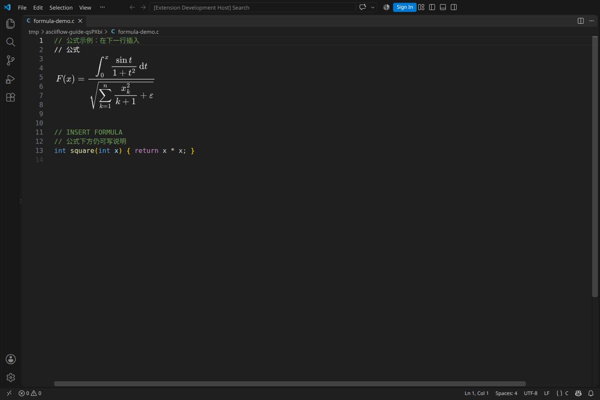

## 从哪里开始

- **第一次使用：**先完成下面的“插入第一个公式”，再跟着“两节点流程图”练习。
- **找不到操作：**在代码编辑区点击右键 → **CommentInk**。也可打开命令面板，搜索 **CommentInk**。
- **随时查帮助：**右键 → **CommentInk → 使用指南**，或在命令面板执行 **CommentInk：使用指南**。插件内的图文指南和截图可离线阅读。

命令面板快捷键：Windows / Linux 为 `Ctrl+Shift+P`，macOS 为 `Cmd+Shift+P`。下文的 `Ctrl` 在 macOS 通常对应 `Cmd`。

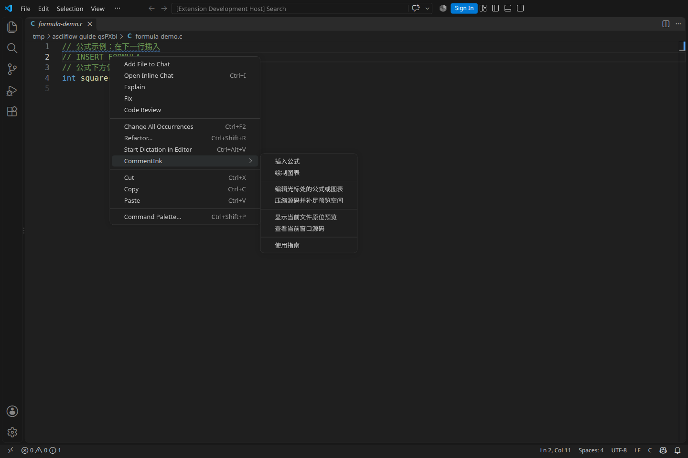

## 1. 安装与准备

1. 在 VS Code 扩展面板搜索 **CommentInk**，核对发布者为 **zuoye** 并安装。使用本地文件时，打开扩展面板右上角的 `…` → **从 VSIX 安装…**，选择安装包。
2. 如 VS Code 提示重新加载窗口，先完成重新加载。
3. 打开自己的源文件，例如 `.c`、`.cpp`、`.py`、`.js` 或 `.ts`。确认右下角显示正确的语言模式，而不是“纯文本”。
4. 把光标放在要插入对象的**独立行**。可以在普通代码行之前插入，也可以在完整块注释的内部插入；无需自己预先写 `@math` 或 `@diagram`。

建议先在一个练习文件中操作，例如：

```c
// 在下一行插入公式或图表

int square(int x) {
    return x * x;
}
```

在空行右键新建后，插件会根据当前语言自动生成注释。不要在字符串内部、脚本声明行、续行或混合语言的嵌入区域中尝试插入。

**需要 VS Code 1.142.0 或更新版本。** 下列截图和操作在 Linux / VS Code 1.142.0 的真实桌面编辑器中测试；其他操作系统、Remote 和 Web 尚未完成同等范围验收。

若你装过发布者为 `local` 的早期本地包，请先禁用旧包，再启用 `zuoye` 版本，避免两份插件同时响应相同命令。源文件中的已保存数据可继续读取；旧包尚未应用的草稿不会自动迁移。

## 2. 插入第一个公式：分式中嵌套根号

本练习做出分子为 `x`、分母为根号 `y` 的公式。

1. 在目标行点击右键 → **CommentInk → 插入公式**。
2. 公式编辑标签打开后，初始模板是分式。在上方输入框填 `x`，下方输入框填 `y`。
3. **先点击分母输入框**，再点击模板栏的 **根号**。根号会放进当前选中的分母位置，不会替换整个公式。
4. 检查上方的排版预览。输入后稍等片刻，预览会自动更新。
5. 点击右上角 **应用到注释**。编辑标签关闭，返回源文件中的原位预览。
6. 保存源文件。只有保存文件后，数据才真正写入磁盘。

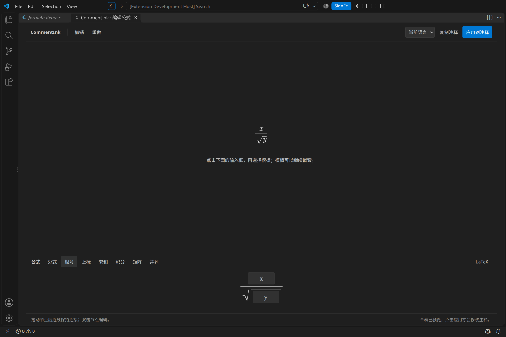

下图是应用后的结果。公式上方和下方的普通代码、文字注释仍可继续编辑。

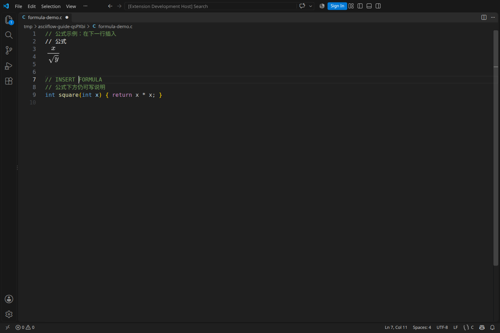

### 公式模板怎么用

模板作用于**最后聚焦的公式输入位置**。需要嵌套时先点目标输入框；想从头新建另一条公式时，请在代码中新建一个独立公式。

| 模板 | 用法 |
|---|---|
| 分式 | 分别填写分子和分母；任一部分还可嵌套模板 |
| 根号 | 填写根号内容 |
| 上标 | 分别填写底数和上标；下标等高级写法可用 LaTeX |
| 求和 | 填写上下限和求和内容 |
| 积分 | 填写上下限、被积内容和积分变量 |
| 矩阵 | 默认 2×2；逐格填写，点击矩阵内输入格后可“加一行”“加一列”，当前模板最多 4×4 |
| 并列 | 将多段表达式放在同一个公式中 |

普通输入框适合数字、变量和简单表达式。要输入 TeX 命令、复杂对齐或模板未覆盖的结构，请使用 LaTeX 模式。输入不完整时可以继续修正；应用前必须通过校验。

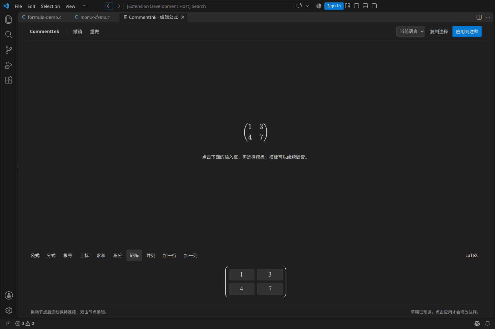

### 直接输入复杂 LaTeX

1. 在公式编辑器中点击模板栏右侧的 **LaTeX**。
2. 在出现的源码框里输入数学表达式，**不用再加 `$…$`、`$$…$$` 或整个 LaTeX 文档结构**。
3. 检查上方实时排版，确认后点击 **应用到注释**。

可以复制下面的完整数学表达式试用：

```latex
F(x)=\frac{
  \displaystyle\int_0^x \frac{\sin t}{1+t^2}\,\mathrm{d}t
}{
  \sqrt{\displaystyle\sum_{k=1}^{n}\frac{x_k^2}{k+1}+\varepsilon}
}
```

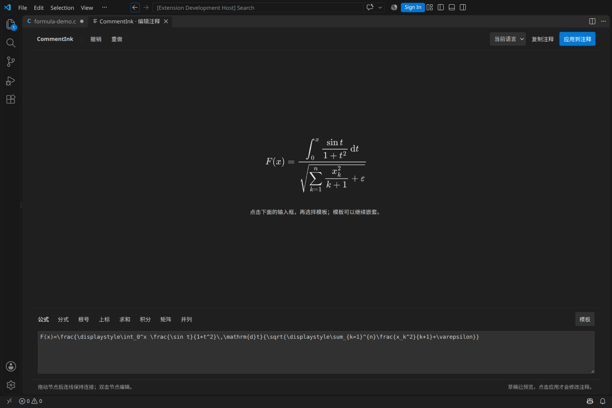

这里使用 MathJax 的 TeX 数学语法，不是完整的 LaTeX 文档编译器。实际改写为原始 LaTeX 后，暂不能自动还原成模板树；可继续编辑 LaTeX，或在仍有撤销历史时撤销修改。切换模式不会替你丢弃原文。

## 3. 创建“两节点、一条箭头”的流程图

1. 在代码的目标行点击右键 → **CommentInk → 绘制图表**。
2. 点击顶部 **方框**，在画布空白处按住鼠标左键拖出一个框；再拖出第二个框。
3. 切换到 **选择**，点击第一个框，在右上角的 **文字** 框中填 `输入 x`；再给第二个框填 `输出 z`。
4. 切换到 **连线**，依次点击起点框和终点框，得到连接两个对象的箭头。
5. 切回 **选择**，点击连线，在右上角 **连线标签** 中填 `处理`。还可以选择单向、双向或无箭头。
6. 点击左下角 **适应内容**，检查整体布局；需要时拖动节点调整位置，连线会继续连接对应节点。
7. 点击 **应用到注释**，返回代码并保存文件。

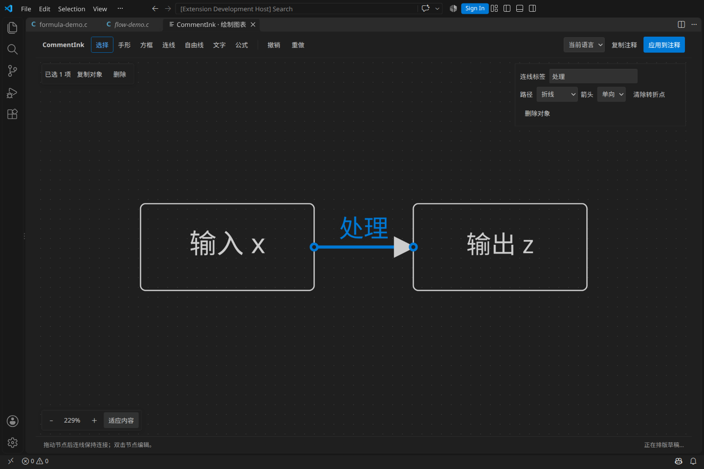

### 顶部工具栏速查

| 控件 | 用途与操作 |
|---|---|
| 选择 | 点击选中；拖动对象移动；在空白处拖动框选；`Shift` 点击增减选择 |
| 手形 | 拖动画布；也可在画布中按住空格拖动，或用鼠标中键拖动 |
| 方框 | 在空白处拖出节点；之后用右上角“文字”修改标签 |
| 连线 | 依次点击两个节点，建立保持关联的连接 |
| 自由线 | 拖动绘制折线；端点靠近节点时吸附，按住 `Alt` 可保持自由端点 |
| 文字 | 在画布中拖出独立文字对象，再填写文字 |
| 公式 | 点击已有节点，为它添加公式；也可在空白处拖出独立公式对象 |
| 撤销／重做 | 撤销或恢复画布、公式草稿中的内容修改 |
| 当前语言 | 指定“复制注释”采用当前文件、Python 或 JS / TS 的注释形式 |
| 复制注释 | 复制一个完整、可独立粘贴的数据块；不修改当前源文件 |
| 应用到注释 | 把当前草稿写入原文件；已有对象会更新原块，新对象会插入到目标行 |

### 在图表里放公式

创建或选中节点后，点击 **公式** 工具再点节点，或选中节点后点属性区的 **编辑公式**。公式区的模板与独立公式使用方式相同。节点文字可以作为公式的标题。

例如在独立公式节点的分子填 `x-μ`，分母填 `σ`。模板中直接输入希腊字符即可；需要 `\mu`、`\sigma` 等命令时改用 LaTeX 模式。完成后可点 **收起** 把空间留给画布。

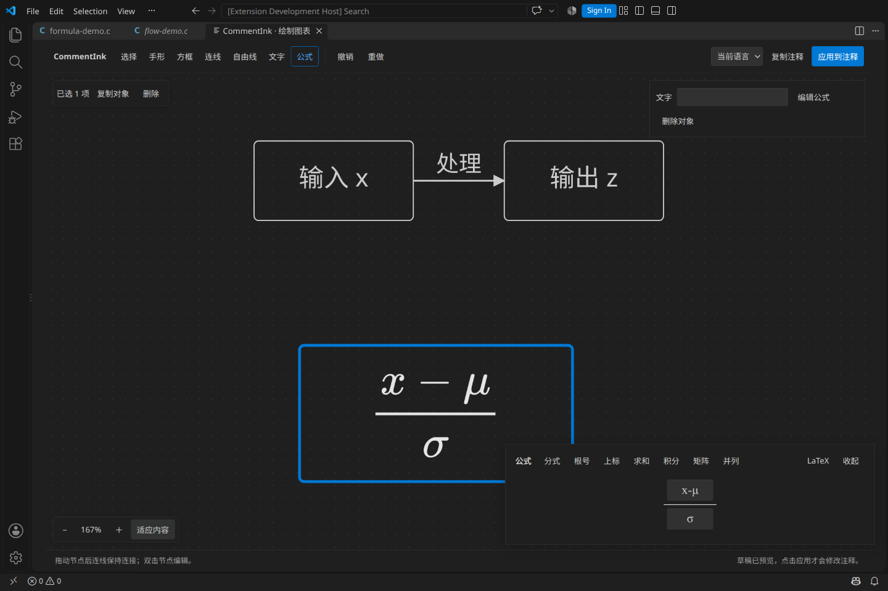

## 4. 整理画布：多选、自由线、缩放和避让

### 多选与移动

- 切换 **选择**，在空白处拖出选框；内部连线会随所选节点一起纳入选择。也可用 `Shift` 点击逐个增减。
- 选中多个对象后，拖动一个已选节点即可移动整组。
- 左上方会出现 **复制对象**、**删除** 等操作；选中至少两个节点时可用 **左对齐**、**顶对齐**。
- 单选节点时，拖动右下角的小方块可调整尺寸。
- **复制对象**只在当前画布内复制；跨文件请使用右上角 **复制注释**。

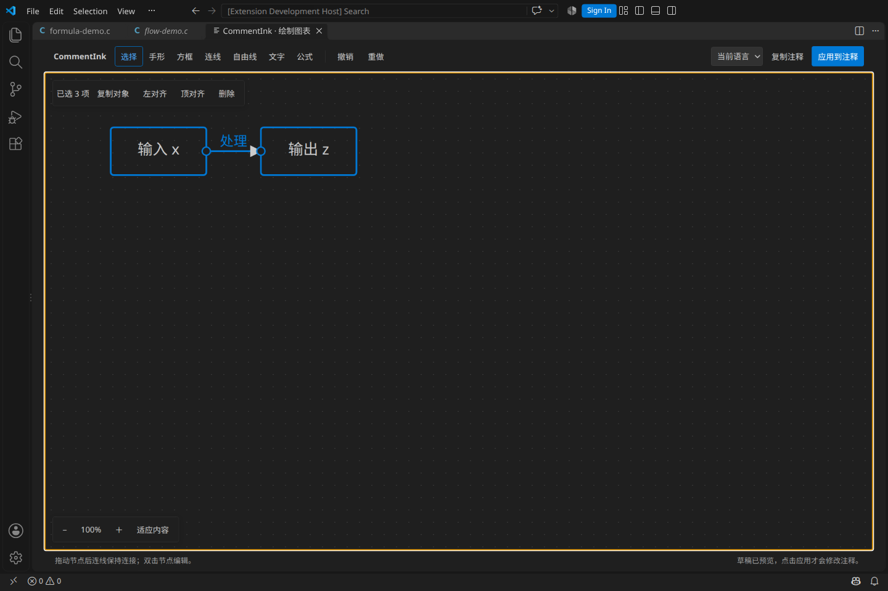

### 自由线与转折点

1. 点击 **自由线**，在空白处拖出线段。按住 `Alt` 可以不连接任何节点。
2. 切换 **选择**，点击线段；拖动两端的圆点可调整端点，拖到节点上可接入节点。
3. 双击线段添加转折点，拖动转折点调整路线；双击转折点可删除它。
4. 在属性区修改标签、箭头和路径；**清除转折点**会移除手动折点，可撤销。

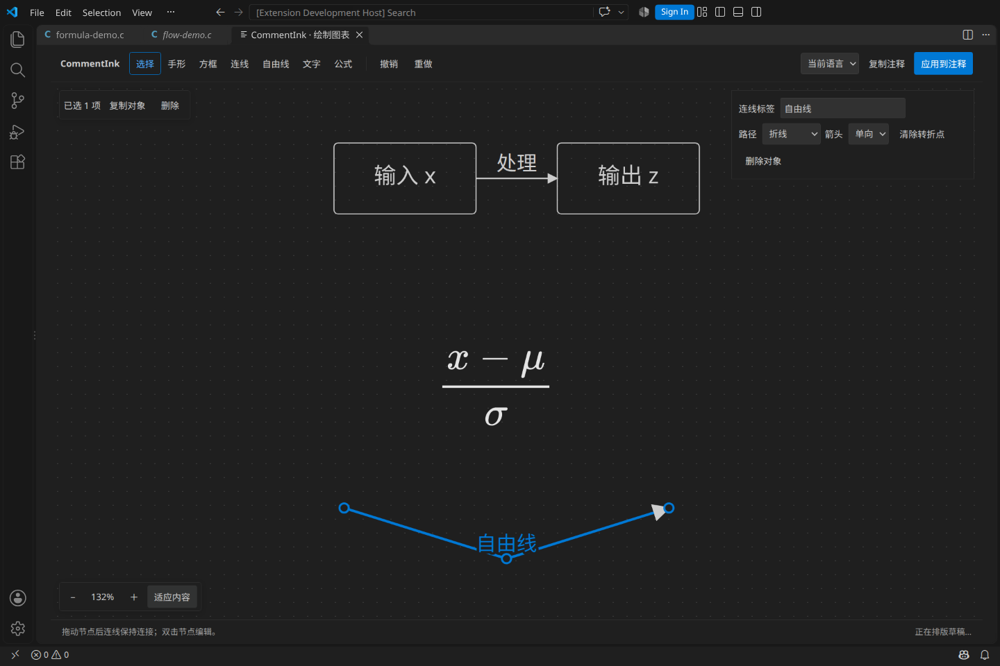

### 平移与缩放

- **手形**或空格拖动：平移画布。
- 左下角 `−` / `＋`：缩小／放大画布；点击百分比恢复默认视图。
- **适应内容**：让当前对象整体进入视野。
- 鼠标滚轮平移；`Ctrl` / `Cmd` 加滚轮缩放。

画布缩放仅改变观看方式，不会改变保存的对象坐标。它与 VS Code 的界面／编辑器字体缩放是两件事。

### 对象重叠和连线冲突

出现重叠时，画布会标示冲突，并在右下角显示 **避让重叠**。点击后整理所选节点；未选择节点时整理全部节点。自动整理不会在你拖动时偷偷启动。

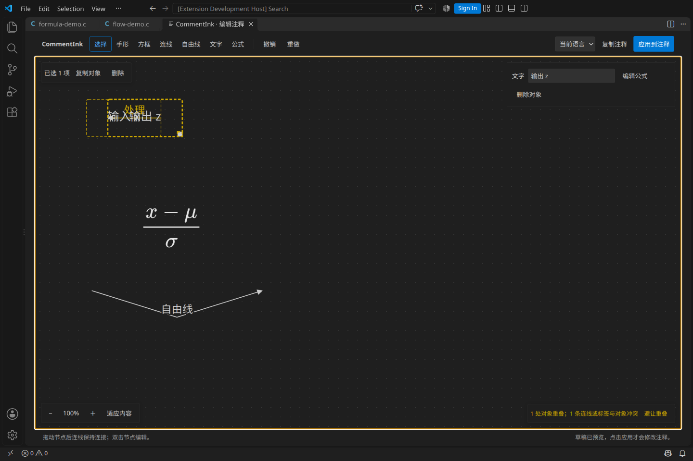

整理后仍可能有连线或标签冲突，需要继续拉开节点、移动折点、缩短标签，或尝试 **直角避让** 路径。它不保证任意图都完全无交叉；不满意可用 **撤销** 恢复位置。

### 常用画布快捷键

以下快捷键用于画布获得焦点时；公式或文字输入框获得焦点时，按键优先用于输入。

| 按键 | 操作 |
|---|---|
| `Ctrl/Cmd+A` | 选择画布中的全部对象 |
| `Ctrl/Cmd+D` | 复制所选对象 |
| `Delete` / `Backspace` | 删除所选对象 |
| 方向键 | 小步移动所选对象；加 `Shift` 为大步移动 |
| `Ctrl/Cmd+Z` | 撤销草稿修改；`Ctrl/Cmd+Shift+Z` 重做 |
| `Esc` | 取消正在进行的绘图或拖动手势 |

## 5. 阅读、修改与继续写文字

### 点击看源码，离开恢复预览

文件打开后，插件会自动识别已有的有效数据：

- 光标和选区都在数据块外时，显示公式或图表。
- 点击预览，或用键盘把光标移入数据块时，恢复可编辑源码。
- 所有光标、选区离开后，重新渲染最新有效内容。多光标中只要还有一个在块内，就保持源码可见。

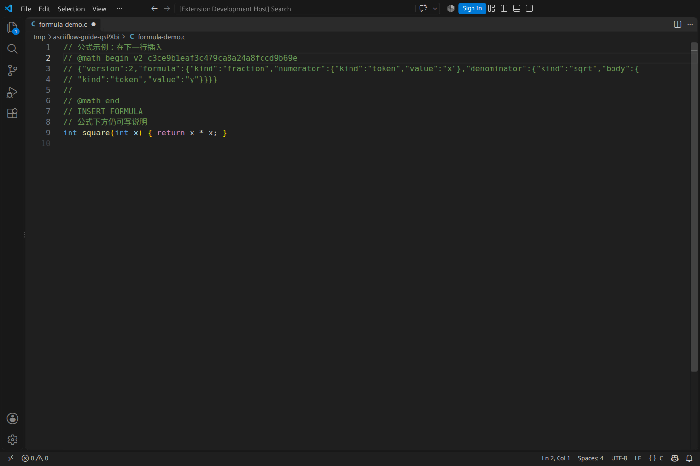

图像上方和下方可以继续写普通文字注释。把说明写在 `@math begin` / `@diagram begin` **之前**，或相应 `end` **之后**；不要写进中间的 JSON 数据里。C 块注释中还要保持文字位于外层 `/* … */` 内。

### 回到图形编辑器修改

1. 把光标移入对应公式或图表的数据块。
2. 右键 → **CommentInk → 编辑光标处的公式或图表**。
3. 修改后点 **应用到注释**。更新只替换该对象的数据，保留它的标识及周围代码。

关闭编辑标签表示取消本次应用，不会把草稿写入原文件。应用后如需撤回，把焦点放回代码文件，使用 VS Code 的撤销；在画布里撤销只操作草稿。

### 手动保持整个窗口为源码

右键 → **CommentInk → 查看当前窗口源码** 会保持当前窗口的源码模式，适合持续检查或复制数据。此时仅把光标移出去不会恢复图片；请执行 **显示当前文件原位预览**，恢复自动切换。

## 6. 复制到另一个文件或另一种语言

1. 从原数据块打开编辑器。
2. 在右上角选择目标注释语言：**当前语言**、**Python** 或 **JS / TS**。
3. 点击 **复制注释**，看到成功提示后，切换到目标文件粘贴。
4. 把光标移出数据块，等待自动预览，再保存文件。

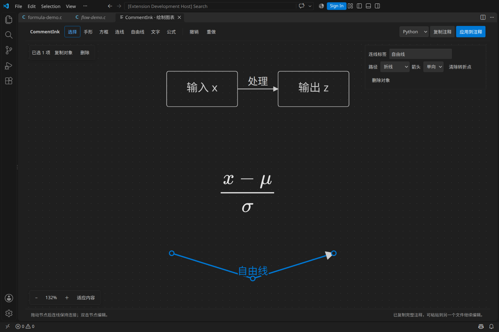

C、HTML 等目标可以选 **当前语言**，让插件使用该文件的注释形式；跨到 Python 或 JS / TS 时可以直接选对应项。只有这三个复制选项，不需要在下拉框中寻找全部语言。

复制会生成新的块标识，因此同一个文件中也能有多个独立对象。直接手工复制整个源码块会把标识一并复制；若诊断提示“同一文件中标识重复”，请改用 **复制注释** 生成新副本。

粘贴的是文本数据，不是系统剪贴板中的图片。安装了 CommentInk 的目标环境可以继续渲染、继续编辑；没有插件时仍保留原始数据。

## 7. 不同语言的注释规则

插件根据文件当前的语言模式选择注释形式，不按文件内容猜语言。普通代码区域中新建时自动包装成合法注释；在完整块注释内部新建时保留已有外层包装。

| 场景 | 使用方式 |
|---|---|
| C / C++ / Java / JS / TS 等 | 使用相应的行注释或块注释；C 风格块内允许可选装饰星号 |
| Python | 默认新建为逐行 `#` 注释；带完整标记的三引号是单独支持的字符串载体 |
| HTML / XML / CSS 等块注释形式 | 在普通代码位置新建时生成完整块包装；在已有块内使用独立行 |
| JSONC | 可以使用注释；严格 JSON 文件不能插入注释 |
| 纯文本、未知或缺少语法的模式 | 切换到实际语言，或先安装相应语言支持 |

已有测试覆盖的语言／模式包括 C、C++、C#、Java、Go、Rust、Dart、Swift、Objective-C、Python、JavaScript、TypeScript、JSX、TSX、Ruby、Shell、PowerShell、PHP、Lua、SQL、R、HTML、XML、CSS、SCSS、Less、YAML、Makefile、Dockerfile、Perl、Markdown、JSONC、Batch、INI、LaTeX、Julia、Clojure、F#、Groovy。第三方语言还需提供可用的语法与注释配置；此列表不代表所有方言和嵌入区域均可用。

### 标记之前可以写什么

通常让插件生成数据即可。手动维护时，标记必须独占一行：

```c
/*
 * @math begin v2 example
 * …这里是插件生成的完整数据…
 * @math end
 */
```

上例仅说明包装，`…` **不是可直接渲染的数据**。标记前可以没有装饰星号，也可以有空格、Tab；C 风格块内兼容重复装饰星号。`//`、`/*` 等是否有效取决于当前语言的实际注释结构，不要把它们当成任意可叠加的装饰。

下面这种形式会提示错误，因为 `4324` 是额外内容：

```c
 *4324 @math begin v2 example
```

删除额外内容，或把说明移到上一行后，再把光标移出数据块。可以通过 **查看 → 问题** 面板查看具体原因。

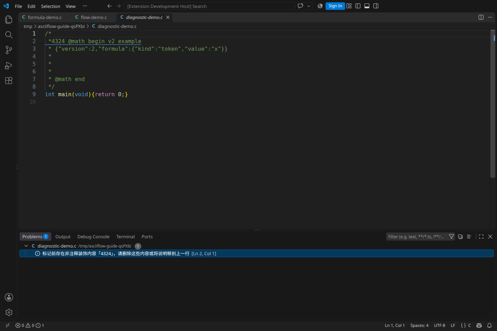

### Python 三引号扩展

默认识别普通、`r` / `R`、`u` 三引号字符串中的完整独占标记块，也支持 docstring。起止引号各占独立行；引号内部除了一个完整的标记数据块之外只留空白。普通说明字符串、带 `# @math` 的示例字符串不会被当作此模式处理；f 字符串和 bytes 暂不支持。

这仍然是 Python **字符串**，应用编辑会更新字符串内容；插件会在编辑器中说明。预览本身不修改字符串。数据按源文拼写读取，不执行 Python，也不计算运行时的字符串转义。新建和复制仍默认生成真正的 `#` 注释，不自动创建 docstring。

## 8. 预览空间、源码长度与文件保存

图表越高，需要的显示空间通常越多；两个同样是“两节点一箭头”的图，也可能因节点位置不同而占用不同行数。

- 插入、应用和复制时使用紧凑 JSON，并按图片高度补最少的空白注释行。
- 旧数据过长或缺少空间时，把光标放入目标块，执行 **压缩源码并补足预览空间**。这是明确修改源文的操作，可一次撤销。
- 普通预览、滚动和缩放不会偷偷补行。
- 手动删除空白占位行后，如果空间不足，插件会显示源码并提示缺少几行。可以补回合法空白注释行，或执行上述整理命令，然后移出光标重试。
- 对象太宽时，请在画布里缩短标签、缩小节点或调整布局。仅把画布视图缩小，不会把保存的图形尺寸缩小。

这里依靠真实数据行容纳图像，没有让编辑器按任意图片高度自动撑开。VS Code 的界面缩放和单独的编辑器字体缩放也可能影响显示；独立字体缩放尚未完整适配，异常时先恢复常用字号／行高再试。

## 9. 草稿、只读与恢复

| 情况 | 应如何处理 |
|---|---|
| 还在画布里编辑 | 内容是草稿，只有点“应用到注释”才进入原文件 |
| 已应用但文件标签仍有未保存标记 | 保存源文件，才能落盘 |
| 想放弃这次修改 | 关闭画布标签，不会自动应用 |
| 正常退出后恢复编辑 | 保持草稿标签打开，让 VS Code 正常退出并恢复会话；恢复后先检查目标，再决定是否应用 |
| 源文件被别人或自己改过 | 插件会检查冲突；保留草稿，核对源文后再处理，必要时先复制注释取回内容 |
| 文件或编辑器只读 | 新增／修改入口可能置灰，或应用被拒绝；解除只读后重试，或复制到可写文件 |
| 需要重命名文件 | 优先通过 VS Code 的资源管理器操作；已有编辑会话会跟随受支持的文件／父目录重命名 |

完整退出恢复已有本机限定测试；不承诺断电、强制终止或全部跨工作区恢复情况。不要把未应用的草稿当成已经保存在源文件中的内容。

## 10. 常见问题与自检

| 现象 | 处理步骤 |
|---|---|
| 找不到 CommentInk 菜单 | 确认插件启用，点击实际代码编辑区，检查右下角语言模式；JSON 和纯文本不显示这类菜单 |
| 菜单是灰色的 | 查看文件或当前编辑器是否只读；不要在欢迎页或预览文档里插入 |
| 打开已有文件只看到源码 | 先移出所有光标和选区；若手动保持了源码模式，执行“显示当前文件原位预览”；再看“问题”面板 |
| 公式输入后没有更新 | 稍等排版完成；看编辑器底部错误。检查 TeX 语法、模板是否还有空输入，不要再套 `$` 分隔符 |
| 点击模板替换了意料外的部分 | 操作前先点目标输入框；误操作用编辑器内“撤销”恢复 |
| LaTeX 无法切回模板 | 原始 LaTeX 暂不支持无损反向转换；继续使用 LaTeX，或撤销到原模板状态 |
| 保存后仍显示源码 | 查看数据错误、重复 ID、未知版本、空间不足、过宽及标记前缀诊断；错误未修复前会保留源码 |
| 普通文字导致 JSON 报错 | 将说明移到 begin 之前或 end 之后，不要写在数据正文中 |
| 显示错位或遮挡 | 恢复常用字体／行高，检查占位行是否被删，必要时显式整理空间；避免通过删标记“修图” |
| 关闭重开后看不到图片 | 确认已保存、插件已启用、语言正确、光标在块外；普通完整重启会自动识别，不需要再插入一个对象 |
| 担心应用错了文件 | 编辑时不要切换目标来“搬运”对象；跨文件使用复制注释。出现冲突先保留草稿 |

如果需要反馈问题，请附 VS Code 版本、语言模式、复现步骤、相关诊断及最小数据块。截图可帮助定位显示问题；提交前请去掉源码中的敏感内容。

## 11. 完成一次练习，检查是否掌握

- 能用右键新建一个分式，并在分母中嵌套根号。
- 能用画布画两个节点，连接箭头，填写节点文字与连线标签。
- 能移动节点、多选、撤销，并区分画布缩放与对象真实尺寸。
- 能应用、保存，然后重新打开已有对象继续修改。
- 能点击进入源码、移出恢复预览，并识别手动整窗口源码模式。
- 能复制一份 Python 注释到另一文件，并避免重复标识。
- 能根据“问题”面板修正非法前缀和空间不足，知道何时应保留原文。

## 许可与资源

图标基于 Lucide Pen Tool（ISC），使用蓝底白色笔尖变体；完整许可随扩展的 `media/LICENSE-Lucide` 提供。公式引擎及字体随包附带各自许可。图形与公式源码自包含，正常编辑与渲染不需要联网；商店详情页的图片由商店服务提供，插件内“使用指南”使用本地截图。
